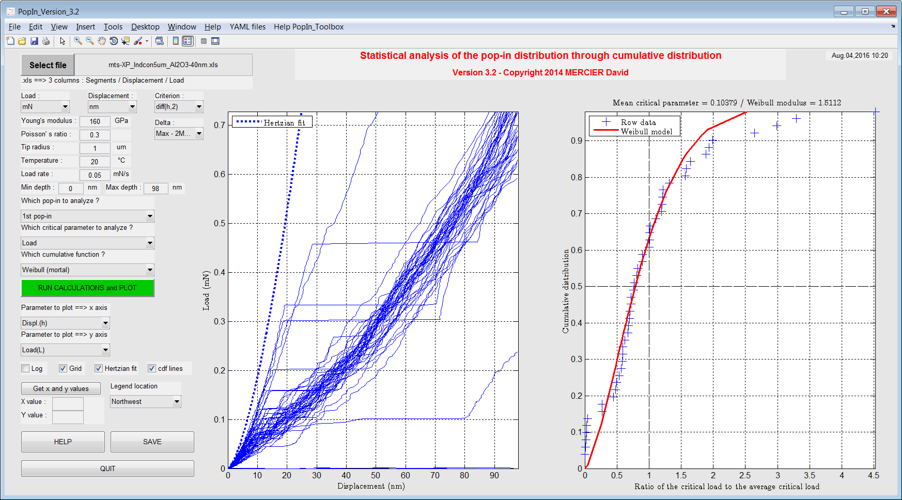

PopIn 4.0
=========
To get started with PopIn, clone the repository, then run Matlab, and cd into the folder containing this README file.
Finally you can start the launcher by typing "demo" at the Matlab command prompt.

See the full documentation at http://popin.readthedocs.org/en/latest/.

Features
----------
The MATLAB graphical user interface can:
    * plot load-displacement curves and fit them with the Hertz model;
    * detect and analyze the first or second pop-in using Weibull, modified Weibull, or time- and temperature-dependent Mason distributions, including survival functions;
    * overlay a probability-density histogram (PDF) on the cumulative distribution plot;
    * calculate pop-in work and, when the required measured inputs are provided, estimate dissipation and fracture toughness.

Python notebook
----------------
The ``python`` folder contains an independent Jupyter notebook for loading MTS
Excel workbooks, detecting pop-ins, and plotting a Weibull cumulative
distribution.
From the repository root, create a Python environment, then run::

    python -m pip install -r python/requirements.txt
    jupyter lab python/popin_detection.ipynb

Run the notebook cells in order and adjust their settings for your data. The
notebook is independent of MATLAB but does not implement the complete MATLAB
GUI or all its models. See the `Python notebook guide <docs/getting_started.rst#python-notebook>`_
for input format, limitations and interpretation.

Authors
---------
:Author: `David Mercier <david9684@gmail.com>`_ [1,2,3]

[1] `CEA, 17 Avenue des Martyrs, 38000 Grenoble, France <http://www.cea.fr/Pages/le-cea/les-centres-cea/grenoble.aspx>`_

[2] `Max-Planck-Institut für Eisenforschung, 40237 Düsseldorf, Germany <http://www.mpie.de/>`_

[3] `CRM Group, Avenue du Bois Saint-Jean 21, B27 – Quartier Polytech 4, 4000 Liège, Belgium <http://www.crmgroup.be/>`_

Reference papers
------------------

* `Mercier D., "Behaviour laws of materials used in electrical contacts for « flip chip » technologies" (2013). <http://www.theses.fr/2013GRENI083>`_

Acknowledgements
------------------
I acknowledge `Dr. V. Mandrillon <https://www.researchgate.net/profile/Vincent_Mandrillon>`_ from (`CEA <http://www.cea.fr/le-cea/les-centres-cea/grenoble>`_, France (Grenoble))
and to `Dr. M. Verdier <Marc.Verdier@simap.grenoble-inp.fr>`_ from (`SIMaP <http://simap.grenoble-inp.fr>`_, France (Grenoble)), for long discussions and many advices about nanoindentation.

I would like also to acknowledge Eli Billauer for the function `peakdet <https://github.com/DavidMercier/PopIn/blob/master/matlab_code/statistics/peakdet.m>`_ released to the public domain (http://www.billauer.co.il/peakdet.html).

Keywords
-----------
MATLAB ; Python ; Jupyter notebook ; Graphical User Interface (GUI) ;
nanoindentation ; pop-in detection ; load-displacement curve ; Hertz model ;
Weibull ; modified Weibull ; time- and temperature-dependent Mason model ;
cumulative distribution (CDF) ;
survival function ; probability density (PDF) ; histogram ; pop-in energy ;
dissipated energy ; fracture toughness ; KIc ; MTS Excel.

Screenshot
-------------

   
   *Screenshot of the PopIn toolbox.*

Links
--------
http://www.mathworks.fr/matlabcentral/fileexchange/45376--pop-in--analysis-from-indentation-tests
