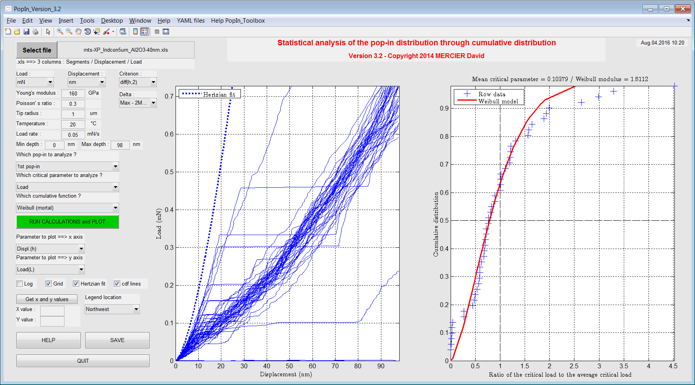

Getting started
================

.. include:: includes.rst

First, download the source code for the |matlab| toolbox.

`The source code is hosted on GitHub. <https://github.com/DavidMercier/PopIn>`_

For more information about using the toolbox, see:

.. code-block:: matlab

   README.rst

Python notebook
###############

The independent Python workflow loads MTS Excel worksheets, detects the
first or second pop-in using the MATLAB criteria and plots the curves and
an empirical and fitted Weibull cumulative distribution. It does not require
MATLAB. It does not implement the GUI, Hertz fitting, modified Weibull,
Mason, survival functions or the pop-in energy workflow.

From the repository root, create and activate a Python environment, then run:

.. code-block:: shell

   python -m pip install -r python/requirements.txt
   jupyter lab python/popin_detection.ipynb

Run all cells in order. The default workbook is the included example. Change
the path and settings in the notebook to use another file. Both ``.xls`` and
``.xlsx`` files are supported: each test worksheet must start with Segment,
Displacement and Load columns and two header rows, followed by samples. The
selected segment marker must occur exactly once in every nonempty worksheet.
The notebook includes the marker row as the final sample; the default
``Hold Segment Type`` therefore selects the loading portion. Set a different
marker only when it represents the intended end of loading. Check the source
units and update the axis labels; no unit conversion is performed.

The default criterion is the MATLAB GUI's second displacement difference with
delta ``max - 2*mean``. Optional depth bounds use an inclusive minimum and
exclusive maximum; unlike the GUI, the notebook does not automatically crop
to the common depth range. Peak indices are zero-based after cleaning and
cropping. The MATLAB-style peak detector needs a subsequent drop greater than
delta to confirm a positive peak, so an unconfirmed final peak is not counted.
Derivative criteria with non-finite values and invalid deltas cause an error:
inspect the data or change the settings rather than interpreting an invalid
result.

The notebook lists curves without the requested event and detected events with
nonpositive critical values, excluding them from the Weibull fit. Exclusion
can bias the distribution; inspect the events and curves before interpreting
results. Fitting requires at least two positive values. The empirical
probabilities follow the MATLAB toolbox's plotting positions and the fit is
least-squares; the fitted Weibull scale is not the arithmetic mean. The
notebook is not a substitute for validating the physical origin of each event.

How to use the GUI for pop-in analysis of indentation tests
#################################################################

GUI stands for Graphical User Interface.

* Run the following |matlab| script :

.. code-block:: matlab

   demo.m
   
* Answer 'y' or 'yes' (or press 'Enter') to add the toolbox to the |matlab| search path by running this script:

.. code-block:: matlab

   path_management.m

The path setup loads its helper functions from ``matlab_code/util``.
Keep this directory name lowercase: MATLAB Online and other case-sensitive
environments distinguish it from ``Matlab_Code``.

Optimization Toolbox is optional for CDF fitting. PopIn checks that the
toolbox is installed, that ``lsqcurvefit`` is on the MATLAB path, and that
its license can be checked out, then runs a small solver availability check.
A successful license check alone does not mean that the toolbox is installed
or usable. If an installation or license check fails, PopIn warns and uses
``fminsearch`` for CDF fits, without parameter bounds. Loading-curve
models that use ``lsqcurvefit`` still require Optimization Toolbox.

If MATLAB reports that ``lsqcurvefit`` requires Optimization Toolbox, check
the installation and active MATLAB path in the same session:

.. code-block:: matlab

   ver optim
   which lsqcurvefit -all
   [status, message] = license('checkout', 'Optimization_Toolbox')

Install or enable Optimization Toolbox for that MATLAB environment if it
is missing. In MATLAB Online, verify the license selected for the session
and restart the session after changing toolbox access. Restart PopIn after
correcting the installation or license so its fitting mode is checked again.

On current MATLAB releases, PopIn uses the supported figure ``Icon``
property rather than the removed ``JavaFrame`` property. Older desktop
releases retain the legacy icon implementation; environments without
either icon API keep the default icon and display a warning.

* The following window opens:

.. figure:: ./_pictures/GUI_Main_Window_empty.png
   :scale: 30 %
   :align: center
   
   *Screenshot of the main window of the PopIn toolbox.*

* Import your (nano)indentation results by pressing **Select file**. The toolbox accepts `.xls` files from MTS software and requires at least 20 indentation tests for statistical analysis.
  Worksheets are read by name, so import also works in MATLAB Online's
  basic spreadsheet-reading mode without Microsoft Excel.
* If segments are present, select the final segment to set the maximum indentation depth.
  The minimum and maximum depth fields are initialized from the finite
  displacement samples common to the imported curves. The text Segment
  column is not used as displacement. To narrow the range, edit the depth
  fields and press **RUN CALCULATIONS and PLOT**; valid inputs can be retried
  after an input error without reloading the workbook.
* Set the units and the criterion for detecting pop-in events.
* Once the dataset is loaded and the parameters are set, run the calculations by pressing the green **RUN CALCULATIONS and PLOT** button.
* The load-displacement curves and selected cumulative distribution function (CDF) are plotted in the left and right graphs, respectively.
* Tick **PDF** above the right-hand plot to overlay a probability-density
  histogram of the selected pop-in load or displacement samples. The CDF
  keeps its left-hand scale; histogram density uses the right-hand scale.
  The histogram uses the same normalized x coordinates as the experimental
  CDF and has unit area, not unit total bar height. Bin widths are selected
  automatically using the Freedman-Diaconis rule. Untick **PDF** to return
  to the CDF-only view. Toggling PDF redraws the plot without refitting.
* Press **SAVE** to create a `.png` image of the main window and save the CDF fit results to a `.txt` file.
* To access the results, enter the following in the MATLAB command window (shown here for 50 indentation tests):

.. code-block:: matlab

   gui = guidata(gcf)
   
   gui =
      config: [1x1 struct]                % GUI configuration
      data_xls: [1x1 struct]              % details about the .xls file
      handles: [1x1 struct]               % GUI handles: buttons, boxes, etc.
      settings: [1x1 struct]              % GUI settings
      flag: [1x1 struct]                  % error and calculation flags
      data: [1x50 struct]                 % cropped data
      results: [50x1 struct]              % calculation results
      Hertz: [1x1 struct]                 % details about the Hertz fit
      cumulativeFunction: [1x1 struct]    % CDF fit results

.. figure:: ./_pictures/GUI_select_segment.png
   :scale: 40 %
   :align: center
   
   *File selector.*

   
   *Load-displacement curves and the Weibull cumulative distribution function after data loading.*
   
.. figure:: ./_pictures/GUI_Main_Window_survival.png
   :scale: 30 %
   :align: center
   
   *Load-displacement curves and the Weibull survival function.*
   

   
   *Load-displacement curves and the modified Weibull cumulative distribution function (Chechenin's model).*
   
Pop-in length, work and conditional fracture estimate
######################################################

After running calculations, click **Pop-in energy / KIc** and choose a curve.
Inspect displacement and load against the cleaned sample index in the preview.
Confirm the start and end samples of the complete burst. The suggested start
uses the first detected peak as a hint only; the end sample must be supplied.
Derivative peaks are not automatic burst boundaries. The nonmodal input dialog
allows zooming and inspecting the preview before confirming the interval.
Click any **blue input label** to open its explanation in a separate help window.
Each link explains the term, units, required values and how to obtain the input;
opening help does not submit the form or change entered values. Help is included
with the toolbox and does not require the documentation website to be published.
Samples are numbered after the current depth crop.
Enter **whole-number sample indices**, not displacement values in nm: for example,
samples ``39`` and ``41``, not their depths ``7.7997`` and ``17.8037``.
Both fields are required, with ``1 <= start < end <= number of samples``.
Invalid boundaries display an explanation and reopen the dialog with all entered
values preserved for correction; they are never silently rounded.

The result window highlights the chosen interval and reports its penetration
length (nm) and trapezoidal applied work (nJ). **Extract another interval** lets
you review a different burst or revise the boundaries. Existing CDF/PDF results
and fitting parameters are not changed.

Leave unknown energy inputs blank: no dissipation or toughness is inferred from
missing information. Dissipation requires an independently estimated change in
stored elastic energy, entered as ``U_after - U_before`` in nJ. Entering zero is
an explicit assumption, not a measured default. A conditional toughness estimate
also requires the incremental projected crack area (um^2), the fraction of
dissipation allocated to fracture (0 to 1), specimen modulus (GPa), Poisson's
ratio, and plane-stress or plane-strain constraint. The material values are
prefilled from the GUI for review; they must describe the cracking material.
Supplying either fracture area or fracture fraction requires all three energy
inputs (elastic energy change, fracture area and fracture fraction). If any are
missing, the GUI lists them and reopens the form with your entries preserved.
For dissipation only, supply elastic energy change and leave **both** fracture
area and fracture fraction blank. For applied work only, leave all three blank.
Do not invent values for unknown inputs just to obtain a toughness estimate.

The **Elastic energy change** and **Incremental projected fracture area** links
include these **illustrative examples, not measured or suggested values for your
sample**:

* Elastic energy change ``-0.0001`` nJ means 0.1 pJ of stored elastic energy is
  released; ``0.0002`` nJ means stored elastic energy increases by 0.2 pJ.
  Entering ``0`` assumes no change and is not a substitute for an unknown value.
  For applied work of 0.000605 nJ and an assumed elastic energy change of
  -0.0001 nJ, the arithmetic gives dissipation
  ``0.000605 - (-0.0001) = 0.000705`` nJ. The correction must still come from an
  independently justified model or measurement.
* For a suitable through-thickness film-crack geometry, new projected area may
  be modelled as film thickness times total newly formed crack length.
  A 40 nm (0.04 um) film with 1 um of new crack length gives ``0.04`` um^2;
  2 um gives ``0.08`` um^2. Do not double the area for the two crack faces or
  substitute penetration length for crack length. Delamination requires a
  different area geometry.

Leave unknown quantities blank rather than adopting these example values.

**Export event CSV** saves the current event, curve number, source path, interval,
energy inputs, stress state and results. Unknown numerical quantities are NaN
in the CSV and shown as ``not calculated`` in the table. Each window represents
one event; export it before closing if you want to retain it.

See :ref:`popin_energy_balance` for the equations and important limitations.

The YAML configuration files
#################################

The default YAML configuration files, stored in the `yaml_config_files <https://github.com/DavidMercier/PopIn/tree/master/yaml_config_files>`_ folder, are loaded automatically to configure the GUI:

* `data_config.yaml <https://github.com/DavidMercier/PopIn/blob/master/yaml_config_files/data_config_popin.yaml>`_
* `indenters_config.yaml <https://github.com/DavidMercier/PopIn/blob/master/yaml_config_files/indenter_config_popin.yaml>`_
* `numerics_config.yaml <https://github.com/DavidMercier/PopIn/blob/master/yaml_config_files/numerics_config_popin.yaml>`_

Update these YAML configuration files to change the indenter properties, model parameters, least-squares fitting parameters, or the path to your datasets.

`Visit the YAML website for more information. <http://www.yaml.org/>`_

`Visit the YAML for MATLAB project page. <http://code.google.com/p/yamlmatlab/>`_

Links
#######

* `Guidata on Matlab website. <https://www.mathworks.com/help/matlab/ref/guidata.html>`_
* `fitdist - Fit probability distribution object to data <http://de.mathworks.com/help/stats/fitdist.html>`_
* `dfittool - Open Distribution Fitting app <http://de.mathworks.com/help/stats/dfittool.html>`_
