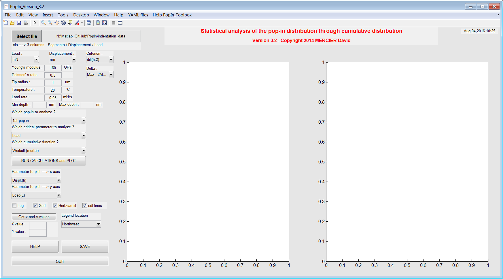
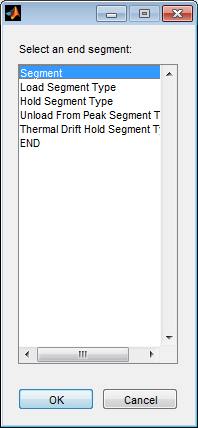
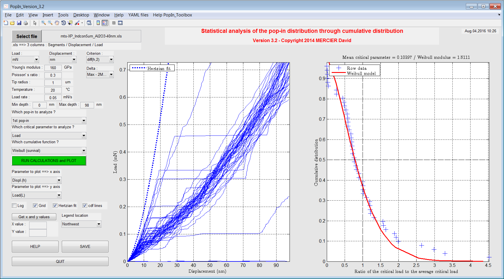

Getting started
================

.. include:: includes.rst

First, download the source code for the |matlab| toolbox.

`The source code is hosted on GitHub. <https://github.com/DavidMercier/PopIn>`_

For more information about using the toolbox, see:

.. code-block:: matlab

   README.rst

How to use the GUI for pop-in analysis of indentation tests
#################################################################

GUI stands for Graphical User Interface.

* Run the following |matlab| script :

.. code-block:: matlab

   demo.m
   
* Answer 'y' or 'yes' (or press 'Enter') to add the toolbox to the |matlab| search path by running this script:

.. code-block:: matlab

   path_management.m

* The following window opens:

   
   *Screenshot of the main window of the PopIn toolbox.*

* Import your (nano)indentation results by pressing **Select file**. The toolbox accepts `.xls` files from MTS software and requires at least 20 indentation tests for statistical analysis.
* If segments are present, select the final segment to set the maximum indentation depth.
* Set the units and the criterion for detecting pop-in events.
* Once the dataset is loaded and the parameters are set, run the calculations by pressing the green **RUN CALCULATIONS and PLOT** button.
* The load-displacement curves and selected cumulative distribution function (CDF) are plotted in the left and right graphs, respectively.
* Press **SAVE** to create a `.png` image of the main window and save the CDF fit results to a `.txt` file.
* To access the results, enter the following in the MATLAB command window (shown here for 50 indentation tests):

.. code-block:: matlab

   gui = guidata(gcf)
   
   gui =
      config: [1x1 struct]                % GUI configuration
      data_xls: [1x1 struct]              % details about the .xls file
      handles: [1x1 struct]               % GUI handles: buttons, boxes, etc.
      settings: [1x1 struct]              % GUI settings
      flag: [1x1 struct]                  % error and calculation flags
      data: [1x50 struct]                 % cropped data
      results: [50x1 struct]              % calculation results
      Hertz: [1x1 struct]                 % details about the Hertz fit
      cumulativeFunction: [1x1 struct]    % CDF fit results

   
   *File selector.*

.. figure:: ./_pictures/GUI_Main_Window.png
   :scale: 30 %
   :align: center
   
   *Load-displacement curves and the Weibull cumulative distribution function after data loading.*
   

   
   *Load-displacement curves and the Weibull survival function.*
   
.. figure:: ./_pictures/GUI_Main_Window_chechenin.png
   :scale: 30 %
   :align: center
   
   *Load-displacement curves and the modified Weibull cumulative distribution function (Chechenin's model).*
   
The YAML configuration files
#################################

The default YAML configuration files, stored in the `yaml_config_files <https://github.com/DavidMercier/PopIn/tree/master/yaml_config_files>`_ folder, are loaded automatically to configure the GUI:

* `data_config.yaml <https://github.com/DavidMercier/PopIn/blob/master/yaml_config_files/data_config_popin.yaml>`_
* `indenters_config.yaml <https://github.com/DavidMercier/PopIn/blob/master/yaml_config_files/indenter_config_popin.yaml>`_
* `numerics_config.yaml <https://github.com/DavidMercier/PopIn/blob/master/yaml_config_files/numerics_config_popin.yaml>`_

Update these YAML configuration files to change the indenter properties, model parameters, least-squares fitting parameters, or the path to your datasets.

`Visit the YAML website for more information. <http://www.yaml.org/>`_

`Visit the YAML for MATLAB project page. <http://code.google.com/p/yamlmatlab/>`_

Links
#######

* `Guidata on Matlab website. <https://www.mathworks.com/help/matlab/ref/guidata.html>`_
* `fitdist - Fit probability distribution object to data <http://de.mathworks.com/help/stats/fitdist.html>`_
* `dfittool - Open Distribution Fitting app <http://de.mathworks.com/help/stats/dfittool.html>`_
