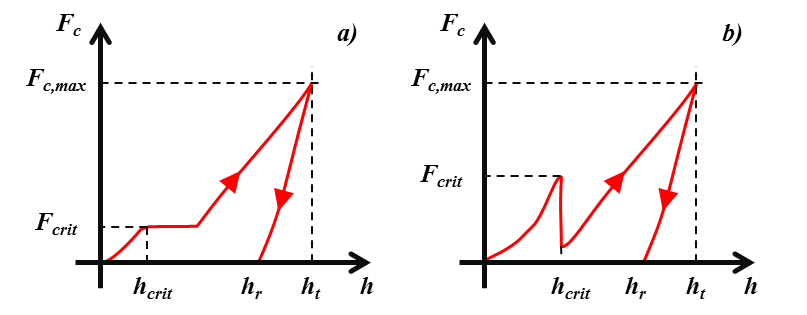
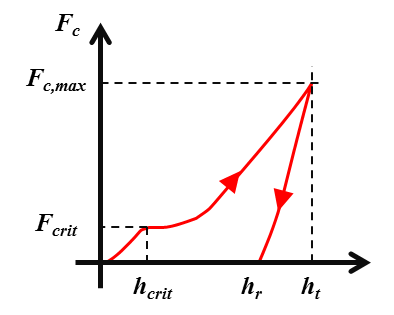
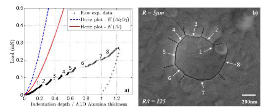
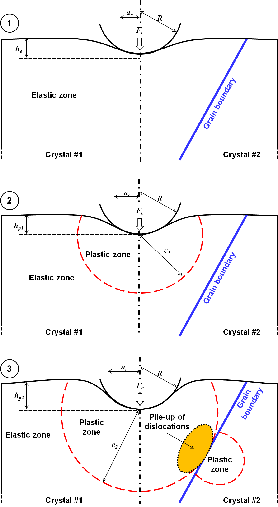
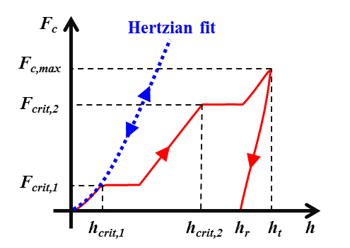
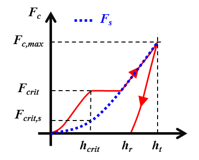
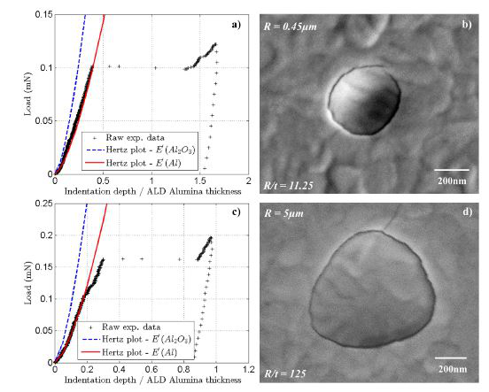
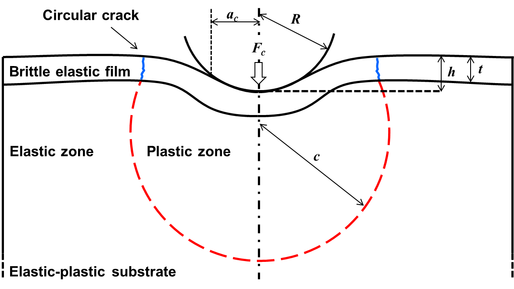

The 'pop-in' phenomenon
==========================

.. include:: includes.rst

Nanoindentation, also known as instrumented or depth-sensing indentation, is a
type of indentation hardness test applied to small volumes. During a test, an
indenter is brought into contact with a sample and mechanically loaded.

The following sections provide a brief overview of models from the literature
that are used to extract the mechanical properties of homogeneous bulk
materials from indentation experiments with conical indenters.

Parameters such as contact load :math:`F_\text{c}` and penetration depth :math:`h` are recorded
at a high rate (typically 10 Hz) during the loading and unloading steps of the indentation test.
Depth resolution is typically on the order of fractions of a nanometer, and load resolution is typically on the order of nanonewtons.

During the loading step of nanoindentation, a discontinuity in the measured depth is commonly referred to as a pop-in event.

The pop-in event
###################

A pop-in is a sudden burst in load or displacement as an indenter is pressed into a sample.
In a load-controlled nanoindentation experiment, a horizontal plateau appears on the
load-displacement curve when a pop-in occurs at the critical load :math:`F_\text{crit}` and
critical displacement :math:`h_\text{crit}` (see :numref:`load_disp_curve_popin`). In a displacement-controlled
nanoindentation experiment, the load drops vertically on the load-displacement curve.

   
        *Schematic load-displacement curves showing a pop-in in (a) a load-controlled and (b) a displacement-controlled nanoindentation experiment.*

:math:`F_\text{c,max}` is the maximum applied load, :math:`h_\text{t}` is the total indentation depth and
:math:`h_\text{r}` is the residual indentation depth.

The |matlab| function used to detect pop-in events by peak detection is:
`peakdet.m <https://github.com/DavidMercier/PopIn/blob/master/matlab_code/third_party_codes/peakdet.m>`_.

.. warning::
    In this toolbox, only load-controlled nanoindentation experiments are analyzed.

Many authors have observed pop-in events in metals and metallic thin films, ceramics, metallic glasses, semiconductors, and hard, brittle thin films deposited on soft elastoplastic substrates.

Pop-in events are often explained by one of the following mechanisms, depending on the specimen (ceramic, metal, semiconductor, coated, or multilayer) and the experimental conditions (time, temperature, indenter geometry, etc.):

        * :ref:`dislocation_nucleation` (sudden yielding of a material under load);
        * :ref:`film_fracture`;
        * :ref:`strain_transfer`;
        * crack formation;
        * phase transformation;
        * amorphization, densification...
    
It is important to note that pop-in events depend on the indenter shape [#Schuh_2004]_, [#Jang_2007]_, temperature [#Schuh_2005]_, and strain rate [#Schuh_2004]_, [#Nieh_2002]_.

However, a pop-in is not always a perfect plateau (with zero slope) on the load-displacement curve. Sliding pop-ins sometimes occur without a clearly observable endpoint. A pop-in can also consist of a series of small plateaus. Some authors have classified pop-in shapes in load-controlled measurements [#Hull_2021]_:
        * Type I: slope :math:`dF_\text{c}/dh = 0`, corresponding to a "perfect" plateau. This is often described as sudden, instantaneous, elastic-perfectly-plastic ("Coulomb-type") failure or sudden grain dislodging.
        * Type II: slope :math:`dF_\text{c}/dh > 0`, corresponding to a sliding pop-in. This may be related to progressive shear-band failure, grain sliding, or progressive pile-up. According to the literature, high-resolution transducers can detect these sliding pop-ins during experiments [#Fu_2016]_.
        * Type III: :math:`dF_\text{c}/dh < 0`, which should not occur in load-controlled indentation tests. If observed, it may indicate an incorrectly configured control loop or an acquisition bug.

   
        *Schematic load-displacement curve showing a sliding pop-in.*
	
Series of small plateaus are most often observed during successive failures of a brittle thin film on an elastic-plastic substrate [#Mercier_2017]_ (see the figure below),
but they can also occur during crystal deformation [#Xia_2016]_.

   
        *Load-displacement curve with relatively small displacement excursions (left) and the corresponding SEM image.*

Some authors have described pop-in statistics using a cumulative Weibull-type distribution [#Chechenin_1995]_ or a cumulative fraction function based on a rate equation when the pop-in behavior depends on time or temperature.

Weibull-type distribution
#################################

The `cumulative Weibull distribution function <https://en.wikipedia.org/wiki/Weibull_distribution>`_
with two parameters, :math:`(\lambda, m)`, is a continuous probability distribution
often used to describe particle-size distributions and in survival or failure analysis [#Weibull_1951]_.

    .. math:: V\left(x, \lambda, m\right) = exp\left(\left(\frac{x}{\lambda}\right)^m\right)
            :label: weibull_survival

    .. math:: W\left(x, \lambda, m\right) = 1 - exp\left(\left(\frac{x}{\lambda}\right)^m\right)
            :label: weibull_mortality

Here, :math:`V` is the survival probability function and :math:`W` is the failure probability function.
:math:`m` is a dimensionless, material-dependent constant, often called the Weibull modulus (usually ranging from 0 to 50) [#Afferante_2006]_.
If :math:`m=1`, the failure rate remains constant, and failures occur randomly.

For multiple indentations performed on the same sample,
:math:`x` can be the distribution of the critical loads :math:`F_\text{crit}` or the critical displacements :math:`h_\text{crit}`,
at which pop-in events occur on the corresponding load-displacement curves. In this case,
the higher :math:`m` is, the more homogeneous the pop-in distribution is.

:math:`\lambda` is the scale parameter of the cumulative Weibull distribution.
For indentation tests, :math:`\lambda` is the mean critical load :math:`F^0_{crit}` or
the mean critical displacement :math:`h^0_{crit}` at which a pop-in event occurs for a given material.

The |matlab| function for calculating the cumulative Weibull failure distribution is:
`weibull_cdf.m <https://github.com/DavidMercier/PopIn/blob/master/matlab_code/statistics/weibull/weibull_cdf.m>`_.

The |matlab| function for calculating the complementary cumulative Weibull survival distribution is:
`weibull_cdf_survival.m <https://github.com/DavidMercier/PopIn/blob/master/matlab_code/statistics/weibull/weibull_cdf_survival.m>`_.

Chechenin et al. proposed using a modified cumulative Weibull distribution function
to describe pop-in statistics [#Chechenin_1995]_.
This function is defined so that the probability is 0.5 when :math:`F_{crit}` (the critical load)
equals :math:`F^0_{crit}` (the mean critical load).

    .. math:: W\left(\frac{F_\text{crit}}{F^0_\text{crit}}\right) = 1 - exp\left(-ln2\left(\frac{F_\text{crit}}{F^0_\text{crit}}\right)^m\right)
            :label: weibull_modified

The cumulative Weibull distribution [#Weibull_1951]_ and the modified cumulative Weibull distribution [#Chechenin_1995]_
are implemented in the PopIn toolbox.

The |matlab| function for calculating the modified cumulative Weibull failure distribution is:
`weibull_modified_cdf.m <https://github.com/DavidMercier/PopIn/blob/master/matlab_code/statistics/weibull/weibull_modified_cdf.m>`_.

The |matlab| function for calculating the complementary cumulative modified Weibull survival distribution is:
`weibull_modified_cdf_survival.m <https://github.com/DavidMercier/PopIn/blob/master/matlab_code/statistics/weibull/weibull_modified_cdf_survival.m>`_.

.. _dislocation_nucleation:

Dislocation nucleation
###############################

Many authors have suggested that pop-in corresponds to the nucleation of at least one dislocation during indentation
of crystalline materials (see :numref:`popin_mechanisms_1`) [#Schuh_2004]_, [#Schuh_2005]_, [#Schuh_2006]_, [#Mason_2006]_, [#Wo_2006]_, [#Morris_2011]_,
[#Lu_2012]_, [#Ramalingam_2012]_, [#Wu_2014_1]_, and [#Wu_2014_2]_. Before the pop-in event, the load-displacement curve
obtained with a spherical indenter can be fitted with the Hertz equation (see :numref:`load_disp_curve_two_popin_Hertzian_fit`) [#Johnson_1987]_:

    .. math:: F_\text{c}  = (4/3) E^{*} \sqrt{R^{*}} h_\text{crit}^{1.5}
            :label: Hertz_equation

Here, :math:`E^{*}` is the reduced Young's modulus calculated from the indentation test, as defined by :eq:`reduced_youngs_modulus`, and
:math:`R^{*}` is the reduced radius of the spherical indenter, as defined by :eq:`reduced_radius`.

    .. math:: \frac{1}{E^{*}} = \frac{1}{E_\text{s}^{'}} + \frac{1}{E_\text{i}^{'}}
            :label: reduced_youngs_modulus

Here, :math:`E_\text{s}^{'}` is the reduced Young's modulus of the sample, and :math:`E_\text{i}^{'}` is the reduced Young's modulus of the indenter.

    .. math:: \frac{1}{R^{*}} = \frac{1}{R_\text{s}} + \frac{1}{R_\text{i}}
            :label: reduced_radius

Here, :math:`R_\text{s}` is the radius of the sample (usually :math:`+\infty`), and :math:`R_\text{i}` is the radius of the indenter.

The |matlab| function for calculating the load using the Hertz equation is:
`elasticLoad.m <https://github.com/DavidMercier/PopIn/blob/master/matlab_code/elastic_contact/elasticLoad.m>`_.

The |matlab| function for calculating the displacement using the Hertz equation is:
`elasticDisp.m <https://github.com/DavidMercier/PopIn/blob/master/matlab_code/elastic_contact/elasticDisp.m>`_.

The |matlab| function for calculating the contact radius using the Hertz equation is:
`elasticRadius.m <https://github.com/DavidMercier/PopIn/blob/master/matlab_code/elastic_contact/elasticRadius.m>`_.

The |matlab| function for calculating the reduced value of a variable is:
`reducedValue.m <https://github.com/DavidMercier/PopIn/blob/master/matlab_code/elastic_contact/reducedValue.m>`_.

        *Schematic cross-section of the deformation profile of an elastic-plastic substrate under indentation:
        (1) elastic deformation, (2) elastoplastic deformation (dislocation nucleation), and (3) dislocation transfer across a grain boundary.*
            

   
        *Schematic load-displacement curve with two pop-in events: the first associated with dislocation nucleation and the second with strain transfer across a grain boundary.*
   
The elastic-plastic transition is often studied statistically as a function of temperature :math:`T` and indentation rate :math:`F(t)`.
Schuh C.A. et al. found good agreement between experimental results and a thermally activated mechanism of incipient plasticity
[#Schuh_2004]_, [#Schuh_2005]_, [#Schuh_2006]_, [#Mason_2006]_. They also proposed to use a statistical thermal activation model (see following equations) 
with a stress-biasing term. This model can be used to extract the activation energy :math:`\epsilon-\sigma V`, activation volume :math:`V`,
and attempt frequency for the rate-limiting event that controls yielding :math:`W(F_\text{c})`. The activation energy :math:`\epsilon-\sigma V` consists of
the activation enthalpy :math:`\epsilon` and the stress-bias term :math:`\sigma V`,
where :math:`\sigma` is the biasing stress acting over the activation volume :math:`V`.

    .. math:: \dot{n} = \eta exp\left(-\frac{\epsilon-\sigma V}{kT}\right)
            :label: rate_equation
            
    .. math:: \dot{N} = \eta exp\left(-\frac{\epsilon}{kT}\right)\cdot\int\int\limits_\Omega\int exp \left(\frac{\sigma V}{kT}\right)d\Omega
            :label: global_rate_equation

    .. math:: \dot{F}(t) = \left[1-F(t)\right]{N}(t)
            :label: cumulative fraction function
            
    .. math:: F(t) = 1- exp\left(-\int_{0}^{t}{\dot{N}(t')dt'}\right)
            :label: integrated_cumulative fraction function

    .. math:: \tau_\text{max} = 0.31p_0 = 0.47p_\text{max} = \left(\frac{0.47}{\pi}\right)\left(\frac{4E^{*}}{3R^{*}}\right)F^{1/3}_{crit}
            :label: max_Hertzian_shearStress
            
    .. math:: \Omega \approx Ka^3 = K\left(\frac{3F_{crit}R^{*}}{4E^{*}}\right)
            :label: sampling_volume
            
    .. math:: F_\text{c} = \dot{F_\text{c}}\cdot t
            :label: loadrate

Here, :math:`\dot{n}` is the local rate at which the critical event occurs per unit volume of material;
:math:`\eta` is the pre-exponential frequency factor, :math:`k` is the Boltzmann constant, and :math:`\tau_\text{max}` is the maximum shear stress
under the maximum pressure :math:`p_\text{max}` at a point beneath the indenter in an elastic Hertzian contact [#Johnson_1987]_. :math:`K` is a proportionality constant of order :math:`\pi`.

The |matlab| function for calculating the maximum shear stress is:
`maxShearStress.m <https://github.com/DavidMercier/PopIn/blob/master/matlab_code/elastic_contact/maxShearStress.m>`_.

The |matlab| function for calculating the maximum pressure is:
`maxPressure.m <https://github.com/DavidMercier/PopIn/blob/master/matlab_code/elastic_contact/maxPressure.m>`_.

The |matlab| function for calculating the mean pressure is:
`meanPressure.m <https://github.com/DavidMercier/PopIn/blob/master/matlab_code/elastic_contact/meanPressure.m>`_.

Finally, combining the preceding equations gives a statistical expression for the onset of plasticity in the form of the cumulative fraction function :math:`W(F_\text{c})`:

    .. math:: W(F_\text{c}) = 1-exp\left(-\frac{9KR^{*}\eta}{4E^{*}\dot{F_\text{c}}\alpha^6}exp\left(-\frac{\epsilon}{kT}\right)\left(\beta(\alpha,F_\text{c})\right)\right)
            :label: first_order_analytical_solution
            
    .. math:: \alpha = \left(\frac{0.47}{\pi}\right)\left(\frac{4E^{*}}{3R^{*}}\right)^{2/3}\frac{V}{kT}
            :label: alpha_function
            
    .. math:: \beta = 120exp(-F_\text{c}^{1/3}\alpha) + F_\text{c}^{5/3}\alpha^5 - 5F_\text{c}^{4/3}\alpha^4 + 20F_\text{c}\alpha^3-60F_\text{c}^{2/3}\alpha^2+120F_\text{c}^{1/3}\alpha-120
            :label: beta_function

The |matlab| function for calculating the cumulative survival distribution as a function of load rate and nanoindentation test temperature is:
`mason_cdf.m <https://github.com/DavidMercier/PopIn/blob/master/matlab_code/statistics/mason/mason_cdf.m>`_.

The |matlab| function for calculating :math:`\alpha` is:
`alphaMason.m <https://github.com/DavidMercier/PopIn/blob/master/matlab_code/statistics/mason/alphaMason.m>`_.

The |matlab| function for calculating :math:`\beta` is:
`betaMason.m <https://github.com/DavidMercier/PopIn/blob/master/matlab_code/statistics/mason/betaMason.m>`_.

.. note::
        The mechanical state of the surface (whether dislocations are present after polishing or the surface is dislocation-free)
        can affect pop-in statistics [#Wang_2012]_.
    
.. note::
        See this `GitHub repository <https://github.com/DavidMercier/Matlab_functions/tree/master/mechanicalContact/hertzEquations>`_ for plots of stress distributions at the surface and along the axis of symmetry,
        caused by Hertz pressure acting on a circular area.

Wang D. et al. also proposed an energy-balance model in 2021 for prismatic dislocation loops generated beneath the indenter during pop-in [#Wang_2021]_.

The literature also reports pop-in or strain-burst events
on load-displacement or stress-strain curves from compression tests of metallic nanopillars or micropillars [#Bei_2008]_, [#Crosby_2015]_, and [#Kraft_2010]_. These strain bursts are most often attributed to dislocation nucleation in pillars that were initially dislocation-free.

.. _strain_transfer:
    
Strain transfer across grain boundaries in metals
####################################################

Some authors have observed two pop-in events on the load-displacement curve during indentation near a grain boundary
(see :numref:`popin_mechanisms_1` and :numref:`load_disp_curve_two_popin_Hertzian_fit`).
The first pop-in is usually attributed to dislocation nucleation in the metal
(see the previous section), while the second is related to the nearby grain boundary.
 
The occurrence of such a strain burst is related to slip activity (which depends on the material phase and grain orientation),
grain-boundary resistance (which depends on grain-boundary misorientation [#Wang_2004]_),
local chemistry [#Britton_2011]_ (including impurities and hydrogen embrittlement), prior plastic deformation [#Britton_2011]_,
the distance between the indenter and the grain boundary [#Wang_2004]_,
and other experimental parameters, such as indenter shape and grain-boundary inclination.

The `STABiX MATLAB toolbox <https://github.com/stabix/stabix>`_
was developed to analyze slip transmission in a bicrystal [#Mercier_2015]_, [#StabixDoc_2015]_, and [#StabixRepo_2015]_.

.. _film_fracture:

Fracture of a hard, brittle film on an elastic-plastic substrate
################################################################

When indenting a hard, brittle film (e.g., a native or thermally/anodically grown oxide or an ALD coating)
on an elastic-plastic (ductile) substrate, pop-in events have been observed and linked to film fracture
[#Kramer_2001]_, [#Bahr_2003]_, [#Morash_2007]_, and [#Stauffer_2012]_. A real example from [#Mercier_2017]_ is shown below.

        *Schematic load-displacement curve showing a pop-in event and the load carried by the elastic-plastic substrate.*
   

        *Load-displacement curves showing a pop-in event (left) and the corresponding SEM observations of the substrate (right).*

Some authors have explained that a circumferential crack forms at the elastic-plastic boundary in the substrate [#Bahr_2003]_, [#Morash_2007]_.
The radius :math:`c` of this plastic zone in the ductile substrate is defined by the following equation:

    .. math:: c = \sqrt{\frac{3F_\text{crit,s}}{2\pi\sigma_\text{e}}}
            :label: plastic_zone_radius

Here, :math:`F_\text{crit,s}` is the load carried by the substrate at the critical indentation depth at which pop-in occurs.
It is usually obtained from the power-law relationship :eq:`critical_load_substrate`.
:math:`\sigma_\text{e}` is the yield stress of the ductile substrate [#Hainsworth_1995]_.

    .. math:: F_\text{crit,s} = Kh_\text{crit}^n
            :label: critical_load_substrate

Here, :math:`h_\text{crit}` is the critical displacement at which the pop-in occurs.
The constants :math:`K` and :math:`n` are obtained by fitting the load-displacement curve
from nanoindentation tests performed on the substrate without the brittle film.

        *Schematic cross-section of the deformation profile of a hard, brittle film on an elastic-plastic substrate under indentation.*
   
In :numref:`popin_mechanisms_2`, :math:`R` is the radius of the spherical indenter, :math:`t` is the thickness of the thin film, and :math:`F_\text{c}` is the applied load.
:math:`h` is the indentation displacement, :math:`c` is the radius of the plastic zone in the substrate, and :math:`a_\text{c}` is the contact radius between the indenter and the thin film.

The |matlab| function for calculating the plastic radius :math:`c` is:
`plasticRadius.m <https://github.com/DavidMercier/PopIn/blob/master/matlab_code/plastic_contact/plasticRadius.m>`_.

The |matlab| function for fitting a load-displacement curve is:
`load_displacement_fit.m <https://github.com/DavidMercier/PopIn/blob/master/matlab_code/plastic_contact/load_displacement_fit.m>`_.

MATLAB functions to fit probability distributions
###################################################

* `disttool - Interactive density and distribution plots <http://de.mathworks.com/help/stats/disttool.html>`_
* `fitdist - Fit probability distribution object to data <http://de.mathworks.com/help/stats/fitdist.html>`_
* `dfittool - Open Distribution Fitting app <http://de.mathworks.com/help/stats/dfittool.html>`_

References
#############

.. [#Afferante_2006] `Afferante L. et al., "Is Weibull’s modulus really a material constant? Example case with interacting collinear cracks" (2006). <https://doi.org/10.1016/j.ijsolstr.2005.08.002>`_
.. [#Bahr_2003] `Bahr D.F. et al., "Indentation induced film fracture in hard film – soft substrate systems" (2003). <https://doi.org/10.1023/A:1024979030155>`_
.. [#Bei_2008] `Bei H. et al., "Effects of pre-strain on the compressive stress–strain response of Mo-alloy single-crystal micropillars" (2008). <https://doi.org/10.1016/j.actamat.2008.05.030>`_
.. [#Britton_2011] `Britton T.B. et al., "Nanoindentation study of slip transfer phenomenon at grain boundaries" (2011). <https://doi.org/10.1557/jmr.2009.0088>`_
.. [#Chechenin_1995] `Chechenin N.G. et al., "Nanoindentation of amorphous aluminum oxide films II. Critical parameters for the breakthrough and a membrane effect in thin hard films on soft substrates." (1995). <https://doi.org/10.1016/S0040-6090(94)06494-6>`_
.. [#Crosby_2015] `Crosby T. et al., "The origin of strain avalanches in sub-micron plasticity of fcc metals" (2015). <https://doi.org/10.1016/j.actamat.2015.02.003>`_
.. [#Fu_2016] `Fu K. et al., "Toughness Assessment and Fracture Mechanism of Brittle Thin Films Under Nano-Indentation" (2016). <https://doi.org/10.5772/64117>`_
.. [#Hainsworth_1995] `Hainsworth S.V. et al., "Analysis of nanoindentation load-displacement loading curves." (1996). <https://doi.org/10.1557/JMR.1996.0250>`_
.. [#Hull_2021] `Hull K.L. and Abousleiman Y.N., "SEM analysis of pop-ins manifested in layered porous geological material" (2021). <https://doi.org/10.1557/s43579-021-00102-3>`_
.. [#Jang_2007] `Jang J.-I. et al., "Rate-dependent inhomogeneous-to-homogeneous transition of plastic flows during nanoindentation of bulk metallic glasses: Fact or artifact?" (2007). <https://doi.org/10.1063/1.2742286>`_
.. [#Johnson_1987] `Johnson K.L., "Contact Mechanics" (1987). <http://www.cambridge.org/us/academic/subjects/engineering/solid-mechanics-and-materials/contact-mechanics>`_
.. [#Kraft_2010] `Kraft O. et al., "Plasticity in Confined Dimensions" (2010). <https://doi.org/10.1146/annurev-matsci-082908-145409>`_
.. [#Kramer_2001] `Kramer D.E. et al., "Surface constrained plasticity: Oxide rupture and the yield point process" (2001). <https://doi.org/10.1080/01418610108216651>`_
.. [#Lu_2012] `Lu J.-Y. et al. "Thermally activated pop-in and indentation size effects in GaN films" (2012). <https://doi.org/10.1088/0022-3727/45/8/085301>`_
.. [#Mason_2006] `Mason J. et al., "Determining the activation energy and volume for the onset of plasticity during nanoindentation" (2006). <https://doi.org/10.1103/PhysRevB.73.054102>`_
.. [#Mercier_2015] `Mercier D. et al. "A Matlab toolbox to analyze slip transfer through grain boundaries" (2015). <https://doi.org/10.1088/1757-899X/82/1/012090>`_
.. [#Mercier_2017] `Mercier D. et al. "Investigation of the fracture of very thin amorphous alumina film during spherical nanoindentation" (2017). <https://doi.org/10.1016/j.tsf.2017.07.040>`_
.. [#Morash_2007] `Morash K.R. and Bahr D.F., "An energy method to analyze through thickness thin film fracture during indentation" (2007). <https://doi.org/10.1016/j.tsf.2006.01.043>`_
.. [#Morris_2011] `Morris J.R. et al., "Size Effects and Stochastic Behavior of Nanoindentation Pop In" (2011). <https://doi.org/10.1103/PhysRevLett.106.165502>`_
.. [#Nieh_2002] `Nieh T.G. et al., "Strain rate-dependent deformation in bulk metallic glasses" (2002). <https://doi.org/10.1016/S0966-9795(02)00146-2>`_
.. [#Ramalingam_2012] `Ramalingam S. et al. "Determining Activation Volume for the Pressure-Induced Phase Transformation in β-Eucryptite Through Nanoindentation" (2012). <https://doi.org/10.1111/j.1551-2916.2012.05180.x>`_
.. [#Schuh_2004] `Schuh C.A. and Lund A.C., "Application of nucleation theory to the rate dependence of incipient plasticity during nanoindentation" (2004). <https://doi.org/10.1557/JMR.2004.0276>`_
.. [#Schuh_2005] `Schuh C.A. et al., "Quantitative insight into dislocation nucleation from high-temperature nanoindentation experiments" (2005). <https://doi.org/10.1038/nmat1429>`_
.. [#Schuh_2006] `Schuh C.A., "Nanoindentation studies of materials" (2006). <https://doi.org/10.1016/S1369-7021(06)71495-X>`_
.. [#StabixRepo_2015] `STABiX toolbox repository <https://github.com/stabix/stabix>`_
.. [#StabixDoc_2015] `STABiX toolbox documentation <http://stabix.readthedocs.org/en/latest/>`_
.. [#Stauffer_2012] `Stauffer D.D. et al., "Plastic response of the native oxide on Cr and Al thin films from in situ conductive nanoindentation" (2012). <https://doi.org/10.1557/jmr.2011.432>`_
.. [#Wang_2004] `Wang M.G. and Ngan A.H.W., "Indentation strain burst phenomenon induced by grain boundaries in niobium" (2004). <https://doi.org/10.1557/JMR.2004.0316>`_
.. [#Wang_2012] `Wang L., "Influences of sample preparation on the indentation size effect and nanoindentation pop-in on nickel" PhD Thesis (2012). <http://trace.tennessee.edu/utk_graddiss/1371>`_
.. [#Wang_2021] `Wang D. et al., "Understanding the hydrogen effect on pop-in behavior of an equiatomic high-entropy alloy during in-situ nanoindentation", Journal of Materials Science & Technology (2021). <https://doi.org/10.1016/j.jmst.2021.04.060>`_
.. [#Weibull_1951] `Weibull W., "A statistical distribution function of wide applicability", J. Appl. Mech.-Trans. ASME (1951), 18(3). <http://www.barringer1.com/wa_files/Weibull-ASME-Paper-1951.pdf>`_
.. [#Wo_2006] `Wo P.C. et al., "Time-dependent incipient plasticity in Ni3Al as observed in nanoindentation" (2006). <https://doi.org/10.1557/JMR.2005.0056>`_
.. [#Wu_2014_1] `Wu D. et al., "Effect of tip radius on the incipient plasticity of chromium studied by nanoindentation" (2014). <https://doi.org/10.1016/j.scriptamat.2014.09.017>`_
.. [#Wu_2014_2] `Wu D. and Nieh T.G., "Incipient plasticity and dislocation nucleation in body-centered cubic chromium" (2014). <https://doi.org/10.1016/j.msea.2014.04.107>`_
.. [#Xia_2016] `Xia Y. et al., "Single versus successive pop-in modes in nanoindentation tests of single crystals" (2016). <https://doi.org/10.1557/jmr.2016.193>`_
