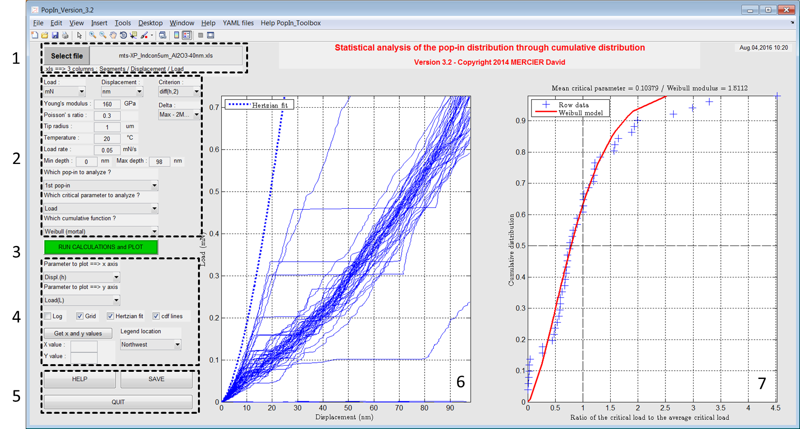

Overview of the toolbox
========================

.. include:: includes.rst

* 1) Import your (nano)indentation results. See the `example file <http://popin.readthedocs.org/en/latest/examples.html>`_.

* 2) Set the units, pop-in detection criterion, experiment temperature, minimum and maximum indentation depths, and pop-in event to analyze. Then select the critical parameter for the Weibull distribution.

* 3) Run the calculations and plot results.

* 4) Set the plots.

* 5) Save an image of the main interface or close it.

* 6) Load-displacement curves showing pop-in events and the Hertz fit.

* 7) Cumulative distribution of the pop-in.

..  note::
    You can modify the YAML configuration files directly from this interface's menu.
    
..  note::
    You can open the documentation from the **HELP** button or the menu.
