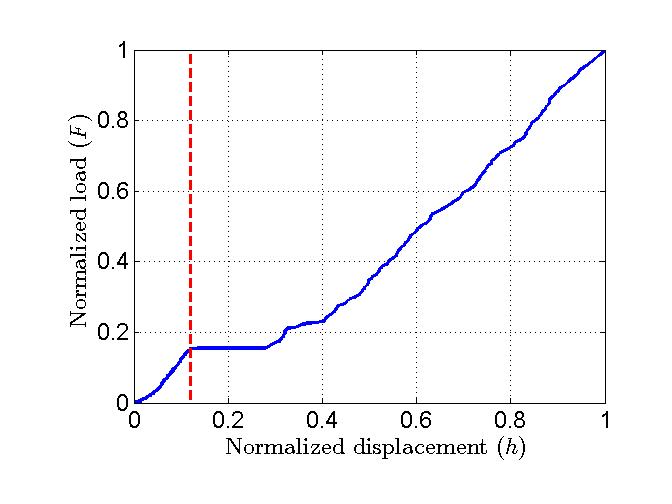
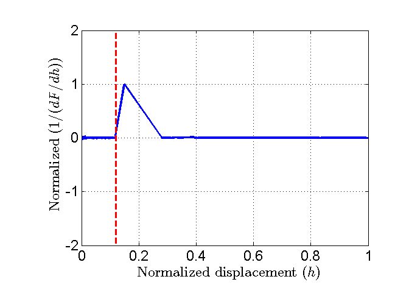
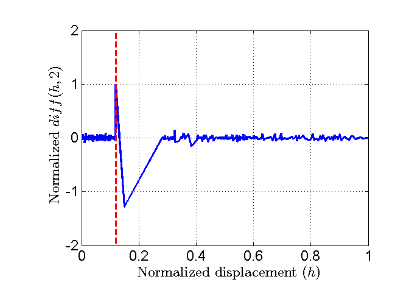
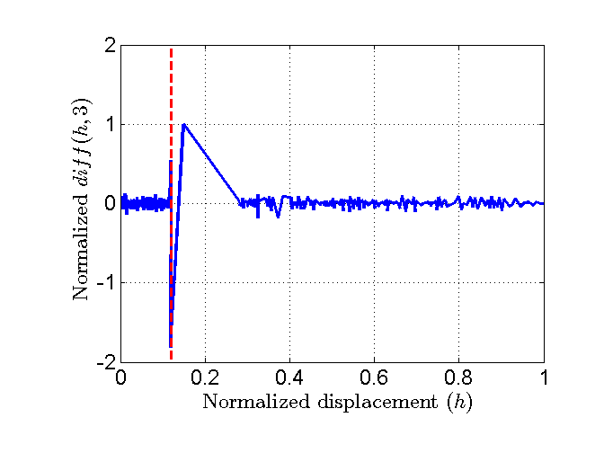
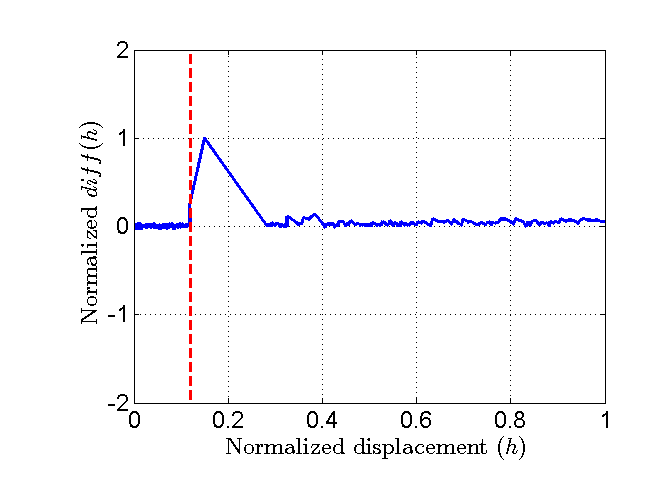
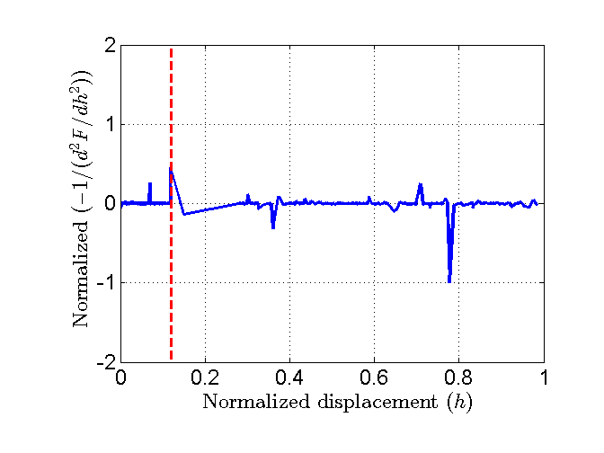
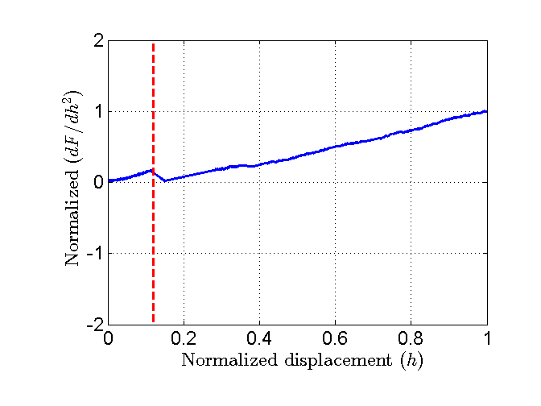

The 'pop-in' detection
==========================

.. include:: includes.rst

Pop-in detection in the literature
###################################################

In 2001, Malzbender J. et al. proposed using the derivative :math:`dF/dh^{2}` versus :math:`h^{2}` of the indentation load-displacement data to detect pop-in events [#Malzbender_2001]_. Minima on these curves correspond to pop-in events on the load-displacement curve.

In 2004, Juliano T. et al. proposed numerically extracting the derivative behavior from the loading and unloading portions of load-displacement curves [#Juliano_2004]_. The numerical first derivative at a depth :math:`h_\text{x}` was defined as the slope of a least-squares fit to the load-displacement data points:

    .. math:: {\left(\frac{dF}{dh}\right)}_{\text{h}_\text{x}} = \frac{y\left(\sum_{F_{\text{x-(y-1)/2}},h_{\text{x-(y-1)/2}}}^{F_{\text{x+(y-1)/2}},h_{\text{x+(y-1)/2}}}{Fh}\right)-\left(\sum_{h_{\text{x-(y-1)/2}}}^{h_{\text{x+(y-1)/2}}}{h}\right)-\left(\sum_{F_{\text{x-(y-1)/2}}}^{F_{\text{x+(y-1)/2}}}{F}\right)}{y\left(\sum_{h_{\text{x-(y-1)/2}}}^{h_{\text{x+(y-1)/2}}}{h^2}\right)-\left(\sum_{h_{\text{x-(y-1)/2}}}^{h_{\text{x+(y-1)/2}}}{h}\right)}
            :label: Juliano_numerical_first_derivative

where :math:`x` is the data-point index and :math:`y` is a positive odd integer representing the number of data points considered.

Juliano T. et al. also proposed calculating the derivative at a depth :math:`h_\text{x}`:

    .. math:: {\left(\frac{dF}{dh}\right)}_{\text{h}_\text{x}} = \frac{F_{\text{x+(y-1)/2}}-F_{\text{x-(y-1)/2}}}{h_{\text{x+(y-1)/2}}-h_{\text{x-(y-1)/2}}}
            :label: Juliano_first_derivative
	    
In 2014, Askari H. et al. developed the following criteria for detecting pop-in events [#Askari]_:

    * Absolute change in depth over 2 lines of data: :math:`\Delta h = h(i) - h(i-1)`
    * Forward 2 pts avg - trailing 2 pts average: :math:`\Delta h = (h(i)+h(i+1))/2 - (h(i-1)+h(i-2))/2`
    * Forward 3 pts avg - trailing 3 pts average: :math:`\Delta h = (h(i)+h(i+1)+h(i+2))/3 - (h(i-1)+h(i-2)+h(i-3))/3`
	
The absolute step size is the difference between two consecutive depth readings from the machine, or between averaged readings when averaging is enabled. If this step size exceeds a user-defined threshold, it is considered a pop-in event.

In her PhD thesis, G. Nayyeri proposed using the first derivative at a depth :math:`h = h_0` on the load-displacement curve to detect pop-in events [#Nayyeri_2016]_:

    .. math:: {\left(\frac{dF}{dh}\right)}_{\text{h}_{0}} = {F_{{\text{h}_{0}}+\Delta \text{h}} - F_{\text{h}_{0}} \over \Delta h}
            :label: Nayyeri_first_derivative

Pop-in detection in the PopIn MATLAB toolbox
###################################################

The PopIn MATLAB toolbox implements several criteria based on the `diff <http://nl.mathworks.com/help/matlab/ref/diff.html>`_ function to detect pop-in events on the load-displacement curve:

    * Criterion 1 - Differences between adjacent depths: :math:`\Delta h = diff(h) = h(i+1) - h(i)`
    * Criterion 2 - 2nd differences between adjacent elements (the diff operator is used 2 times): :math:`\Delta h = diff(diff(h)) = diff(h,2)`
    * Criterion 3 - 3rd differences between adjacent elements (the diff operator is used 3 times): :math:`\Delta h = diff(diff(diff(h))) = diff(h,3)`
    * Criterion 4 - 1st derivative of the load-displacement curve: :math:`1/(dF/dh) = 1/(diff(F)/diff(h))`
    * Criterion 5 - 2nd derivative of the load-displacement curve: :math:`-1/(d^{2}F/dh^{2}) = -1/(diff(dF/dh)/diff(h))`
    * Criterion 6 - Derivative of the load-displacement curve: :math:`(dF/dh^{2}) = ((diff(F)/diff(h))/diff(h))`

The sixth criterion is based on the method proposed by Malzbender et al. [#Malzbender_2001]_.
Malzbender proposed plotting this criterion as a function of :math:`h^{2}` rather than :math:`h`, as implemented in the PopIn toolbox.

When a pop-in occurs, a peak is observed on the plot of differences or derivatives.
Peak analysis is performed using the `peakdet <https://github.com/DavidMercier/PopIn/blob/master/third_party_codes/peakdet.m>`_ function, released into the public domain by E. Billauer (http://www.billauer.co.il/peakdet.html). Only positive peaks are counted. A point is considered a maximum if it has the highest value and is preceded (to the left) by a value lower by a specified delta. The delta value can be set by the user in the GUI.

The plots below show the different criteria, normalized by their maximum values, as a function of normalized indentation displacement (:math:`h/max(h)`).

   
   *Plot of an experimental load-displacement curve displaying a pop-in.*

   
   *Plot of the normalized 1st criterion.*

   
   *Plot of the normalized 2nd criterion.*

   
   *Plot of the normalized 3rd criterion.*
   

   
   *Plot of the normalized 4th criterion.*
   

   
   *Plot of the normalized 5th criterion.*
   

   
   *Plot of the normalized 6th criterion.*

Pop-in energy and conditional fracture estimate
################################################

The MATLAB GUI can calculate the applied work over a selected pop-in interval.
For selected samples :math:`i` to :math:`j`, the applied work is

.. math::

   W_\mathrm{ext}=\int_{h_i}^{h_j}P\,\mathrm{d}h .

If the change in stored elastic energy is supplied, dissipated energy is

.. math::

   Q=W_\mathrm{ext}-(U_\mathrm{after}-U_\mathrm{before}) .

A conditional fracture estimate requires the incremental projected fracture
area :math:`\Delta A`, a supplied fracture fraction :math:`0\leq\eta\leq1`,
specimen elastic properties, and the stress state:

.. math::

   W_\mathrm{fracture}=\eta Q,\qquad
   G_\mathrm{est}=\frac{W_\mathrm{fracture}}{\Delta A},\qquad
   K_\mathrm{est}=\sqrt{E'G_\mathrm{est}} ,

where :math:`E'=E` in plane stress and :math:`E'=E/(1-\nu^2)` in plane strain.
The resulting ``KIc`` is a model-dependent estimate, not a validated toughness
measurement; leave unknown inputs blank rather than assuming values. See
:ref:`popin_energy_balance` for assumptions and limitations, and
:doc:`getting_started` for the GUI workflow and input definitions. For
background on indentation-based thin-film toughness and coating fracture, see
Li et al. [#Li_1997_fracture]_, Li and Bhushan
[#Li_1998_toughness]_, Chen [#Chen_2012_toughness]_, and Favache et al.
[#Favache_2015_fracture]_.

References
#############

.. [#Askari] `Pop-in Detection by Askari H. et al. (2014) <https://nanohub.org/resources/20804>`_
.. [#Juliano_2004] `Juliano T. et al., "Numerical derivative analysis of load-displacement curves in depth-sensing indentation" (2004). <https://doi.org/10.1557/PROC-791-Q7.5>`_
.. [#Li_1997_fracture] `Li X., Diao D. and Bhushan B., "Fracture mechanisms of thin amorphous carbon films in nanoindentation" (1997). <https://doi.org/10.1016/S1359-6454(97)00143-2>`_
.. [#Li_1998_toughness] `Li X. and Bhushan B., "Measurement of fracture toughness of ultra-thin amorphous carbon films" (1998). <https://doi.org/10.1016/S0040-6090(97)00788-8>`_
.. [#Malzbender_2001] `Malzbender J. and de With  G., "The use of the indentation loading curve to detect fracture of coatings" (2001). <https://doi.org/10.1016/S0257-8972(00)01091-4>`_
.. [#Nayyeri_2016] Nayyeri G., "Examination of deformation in magnesium using instrumented spherical indentation", University of British Columbia, PhD thesis (2016).
.. [#Chen_2012_toughness] `Chen J., "Indentation-based methods to assess fracture toughness for thin coatings" (2012), Journal of Physics D: Applied Physics, 45(20), 203001. <https://doi.org/10.1088/0022-3727/45/20/203001>`_
.. [#Favache_2015_fracture] `Favache A. et al., "Fracture mechanics based analysis of the scratch resistance of thin brittle coatings on a soft interlayer" (2015), Wear, 330-331, 461-468. <https://doi.org/10.1016/j.wear.2015.01.081>`_
